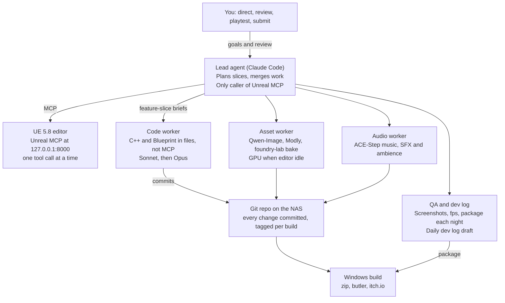

# Epic AI MegaJam 2026 — Win Plan

Oct 27, 2026 · Jared

> Exported from the Claude Docs version of this plan. The architecture diagram is redrawn below as Mermaid.

## Bottom line

Target: a top-3 finish in **Best Overall, Unreal Engine**, which is the gate to a Development Continuation Grant of up to $50,000. The modifier to aim at is **Glass Box** (best dev log), since you already document and verify everything you build.

- **Prize ceiling:** one main-category prize plus one modifier prize per submission (Rule 13). For you that is $7,500 + $2,500, and possibly a grant invitation later. The grant is by invitation, separate from prizes, and not guaranteed (Rule 11).
- **How judges score:** 7 criteria, 5 points each, all equally weighted (Rule 9). A tie is re-scored with **Fun Factor counted twice**. The disclosed amount of AI use counts "for context only." It does not move your score either way.
- **The edge you have:** agents can deliver breadth (code, assets, audio, levels) in 4 days that a solo human can't. The biggest scoring risk in a jam is a dead criterion, like missing audio or a level with no progression. The plan is to get all 7 criteria to a 4, then push **Fun** and **Ambition** to a 5 — chosen before building, not as a general polish goal: Fun is the tiebreaker criterion (Rule 9 doubles it), and Ambition is where a solo dev using agents can credibly beat the room if the one deep mechanic lands (see the Ambition rule below).
- **The biggest blocker today:** UE entries must be packaged for Windows, macOS, Android or iOS, and your desktop runs CachyOS. Unreal can't package a Windows build from Linux. Fixing that is the first prep task (Decision 3).
- **What can't be done before Nov 12:** any gameplay, level or art (Rule 7(h)). Tools, agent configs, MCP settings, prompt libraries and scripts are allowed, and you must declare them.

## What the rules reward and forbid

Four rules matter for strategy. Sourced assets aren't scored, AI-generated content counts as your own original work, judges are told to ignore how much AI you used, and anything built before Nov 12 except tooling disqualifies you. The rest is compliance.

| Rule | What it says | What it means for the plan |
| --- | --- | --- |
| 15(c) | Sourced (Fab etc.) assets "will not be reviewed or scored"; AI-generated content "is not considered a sourced asset" | **Mixed plan (owner 2026-11-06/08):** sourced packs (Kenney, Poly Haven, Fab free) for bulk environment and filler, AI-generated for the few hero and focal pieces. Trade-off: sourced assets earn no Visuals or Audio points, so nothing sourced may be the first thing a judge sees. Log every import with `scripts/sourced_assets.py`. Plan: `stages/02_build/references/sourced-assets-plan.md`. |
| 9 | 7 criteria × 5 points; AI use is "context only"; ties re-scored with Fun Factor doubled | Score the game, not the AI story. Fun is the tiebreaker. |
| 7(h) | Tools, agent configs, MCP settings, prompt libraries, scripts may be prepared early; Epic may ask for version-control history | All prep goes in a git repo with timestamps. No game content before Nov 12, 00:00 ET. |
| 1(b), 7(f) | UE: packaged for Windows (playable on Win 10/11), macOS, Android or iOS; must run with no extra software | No local LLM server, no API key in the build, no runtime dependency the judge has to install. |
| 7(d), 7(e) | UE: not an obvious extension of an Epic tutorial; custom gameplay beyond starter templates | Starting from a template is fine; the mechanic must be your own. |
| 7(c), 7(i) | Video 30–60 s at 1920×1080 or higher; all content and entry info in English | Record at 1080p60 minimum; gameplay in the first 5 seconds (itch page tip). |
| 8 | Teen-rated or below; no third-party IP; no disparaging anyone | No UC2/UT characters or assets, no parody of real brands. |
| 15(d) | No trademarks except the Unreal Engine logo per Epic branding guidelines | Original names and logos only. |
| 10, 13 | Glass Box needs the dev log submitted with the entry during the contest period; one main prize + one modifier max | Dev log link must be in the submission form before 5:59 PM PT Nov 15. |
| 17 | A human must submit; no agent or automated submission | You click Submit on itch.io yourself. |
| 2 | One submission per team | No second entry, no UE + UEFN double-dip. |
| 14 | Winners notified ~Jan 29, 2027; 72 hours to respond with Epic Account ID and Prize Release | Watch the entry email in late January. |

Eligibility check: Washington residency qualifies (US isn't a Restricted Jurisdiction), you must be 18+, and your Epic account can't be a Cabined Account (Rules 1, 5).

## Decisions to make before Nov 1

Five calls shape everything else. Each one has a recommendation; the build box (D3) blocks the most prep work, so settle it first.

| # | Decision | Recommendation | Why |
| --- | --- | --- | --- |
| D1 | Unreal Engine or UEFN (one only, Rule 2) | **Unreal Engine 5.8** | Epic's own Unreal MCP plugin generates a Claude Code config and runs inside the editor. You get full control of rendering, audio and code. UEFN is Windows-only, its Verse API is a known source of hallucinated calls, and LLM NPCs ("conversations") are still Experimental and watermarked. |
| D2 | Solo or team | **Solo, aiming for Glass Box** | Only one modifier can be won. Glass Box plays to your strengths. Best Team ($5k) only makes sense with someone you already work well with; strangers recruited from the forums add coordination cost during the 4 days. |
| D3 | How to produce a Windows build | **Option 1: install Windows 11 on the Legion Go S** (see below) | Unreal can only cross-compile Windows → Linux, not Linux → Windows. |
| D4 | Online or in person at Digital Jungle SF (Nov 14–15) | **Online from home** | Online and in-person entries are judged the same. Travelling on day 3 costs build hours and access to your GPU. |
| D5 | Sponsor AI credits (to be announced) vs local-only generation | **Not local-only (owner 2026-11-07): anything the Official Rules allow; cloud AI is terms-gated and speed-first** | Local was too slow for the asset volume. `gen_asset.py` now has cloud adapters (Grok/GPT images, Meshy 3D) behind key + `*_TERMS_REVIEWED`, with local Krea/TripoSplat as fallback. Details: `_config/reference/ai-providers.md`. Sponsor credits still to be reconsidered when published. |
| D6 | High-risk mechanic vs. the safe fallback, and when to bail | **Write the fork explicitly, with a named decision point on day 3 (Sat, before feature freeze)** | Pursue the ambitious depth-mechanic by default (see Ambition rule), but name the safe fallback now and the exact signal that triggers switching to it, instead of discovering the fallback under pressure. |

**D3 options for the Windows build:**

1. **Develop on CachyOS, package on a Windows box.** Run the UE 5.8 Linux editor, Unreal MCP, Claude Code and the Nexus asset tools on the desktop. Push to git or the NAS, then package the Windows build on the Legion each day. The Legion Go S runs CachyOS today, so this means installing Windows 11 on it, which wipes it. Storage is the tight spot on a handheld: in the Epic Games Launcher, install UE 5.8 with Windows as the only target platform. It needs room for UE 5.8 and, for a C++ project, Visual Studio 2022 build tools and the Windows SDK. Builds will cook slower on a handheld chip, so package overnight. It also doubles as a realistic low-end Windows test device. It keeps the asset pipeline and the editor on one box.
2. **Dual-boot Windows 11 on the desktop for jam week.** Everything Unreal runs on Windows, the platform Epic tests most. The cost: the Linux-only Nexus generation tools aren't on the same boot, so assets would be batched in Linux sessions or moved to cloud tools.
3. **Package for Android from Linux.** Allowed by Rule 1(b), but judges would have to sideload an APK, and the itch page assumes desktop builds. Use this only as a fallback.

Whichever you pick, the prep-week gate is the same: by **Nov 4**, a packaged Windows .exe of a throwaway template project launches on a clean Windows machine.

Note: this reopens Unreal work for the jam only. UC2, UTLegacy and the character packs stay tabled, and none of their assets or code can be used. That's both a third-party-IP problem (Rule 8) and pre-jam content (Rule 7(h)).

## Prep plan, Oct 27 – Nov 11

The goal of prep is that on Nov 12 every hour goes into the game, not into tooling. Everything below is something Rule 7(h) allows. All of it lives in one git repo, so its history proves what existed before the jam.

**Week 1: decide and wire up (Oct 27 – Nov 2)**

- [x] Make decisions D1–D5 (by Nov 1). Settled Oct 27: UE 5.8, solo + Glass Box, Legion Go S build box, online, local first.
- [x] Create the repo (`jf1shh/megajam`). Pre-jam contents are tooling only, per Rule 7(h).
- [x] Read the Official Rules yourself and confirm they still match the Oct 22 version this plan cites. Done 2026-10-27: read all 14 pages of the owner's own uploaded copy of the PDF directly (Epic's Box link still doesn't render for automated fetch). No discrepancies from the Oct 22 "EN_V2" version this plan already cites.
- [x] Back up the Legion Go S, install Windows 11 on it, then install the same exact UE 5.8.x version there and on the desktop. Enable the **Unreal MCP** and **AllToolsets** plugins and run `ModelContextProtocol.GenerateClientConfig ClaudeCode`. Gate: Claude Code lists the toolsets and can spawn an actor and set its properties in a scratch level. (done, see PLAN.md)
- [x] ~~If you choose the in-person event: Eventbrite opens Nov 1, 7 AM PT.~~ (not applicable: online entry chosen 2026-10-27)
- [x] Check itch.io's own edit-after-submit behavior (dashboard settings or support docs) to confirm a submitted jam entry can be replaced with a later upload before the deadline. Gates the Saturday-night insurance upload (Phase 1, day 3).
      (confirmed 2026-10-28, via itch.io's own community support answers: project files can be
      re-uploaded freely while a jam's submission window is still open; MegaJam's Official Rules add
      no restriction on top of that default. No manual test upload needed — proceed with the insurance
      upload as planned.)

**Week 2: pipeline and rehearsal (Nov 3 – Nov 9)**

- [x] **Packaging gate (Nov 4):** a script that runs `RunUAT BuildCookRun` (Development config, Win64), names the zip `TeamName_GameName.zip`, checks it's under 1 GB, and pushes with `butler` to a private itch.io page. Prove it on a throwaway template project, then delete that project. (done 2026-11-02, including the butler push; see PLAN.md)
- [x] **Asset pipeline scripts:** prompt or concept image → Modly image-to-3D → foundry-lab remesh and bake → FBX → UE Python import (naming, collision, LODs, material instance). Record minutes per asset. You'll need that number for jam-day scoping. (done, see PLAN.md)
- [x] **2D and audio scripts:** Qwen-Image for concept art, textures, UI and the itch cover; ACE-Step for 2–3 loopable music tracks; pick an SFX source (local model, or your own recorded foley). Check each model's license allows a contest entry and Epic's publicity license (Rule 15(b)). (done, see PLAN.md)
- [x] **Agent configs:** project `CLAUDE.md` (naming, C++ vs Blueprint rule, the one-MCP-caller-at-a-time rule) and a prompt library: GDD one-pager, concept-scoring rubric, feature-slice brief, playtest checklist, dev log entry template. (done, see PLAN.md)
- [x] **QA harness:** an editor Python script that loads each map, captures screenshots from fixed cameras, and logs frame time. Set a budget of 60 fps at 1080p on the weakest Windows machine you own. Add a soft-lock check alongside it: verify the player can reach the exit from every spawn/checkpoint (see `_config/reference/research/external-strategies-synthesis.md` item 2). (done, see PLAN.md)
- [ ] **Legion Go S perf-budget settings** (starting point, tune from the mock jam): Forward Shading instead of deferred, dynamic Lumen/VSM off, texture cap 2048×2048, 16-concurrent-audio-channel limit, precompiled PSO caches. See `_config/reference/research/external-strategies-synthesis.md` item 5.
- [x] **Capture setup:** OBS profile at 1920×1080, 60 fps, with a 60-second replay buffer on a hotkey, so good moments are saved as they happen. (done, see PLAN.md)
- [x] **Dev log tooling:** a script that turns each day's commits, screenshots and notes into a dated Markdown entry. That entry becomes an itch.io devlog post. (done, see PLAN.md)
- [x] **Mock jam (Nov 7–8):** 24 hours on a made-up theme in a throwaway project. Run the full loop: concept → greybox → assets → package → video. Then delete the project and keep only the tooling fixes. This is the single best predictor of jam-week throughput. (done, see PLAN.md)

**Final days: freeze and rest (Nov 10 – 11)**

- [ ] Tag `pre-jam-tooling`. Generate the declaration list of every prompt, script and config made before the jam. (declaration list done, see PLAN.md; tag not yet created)
- [x] Block the calendar for Nov 11 evening through Nov 15 (done 2026-11-02).
- [ ] Shop and plan meals for Nov 11 evening through Nov 15.
- [ ] Watch the kickoff livestream, Nov 11 at 11 AM PT. The theme is revealed there.

## Agent and tooling setup

One lead agent owns the editor. Epic's docs say Unreal MCP runs tool calls serially on the game thread and clients should not overlap them. Every other agent works in source files and asset tools, and hands results to the lead to import.

- **Models:** your standing route applies. Local models handle grunt work like naming, batch prompts and log parsing. Code and review go to Sonnet, then Opus. The lead runs on Opus. Dev log drafting can use Haiku.
- **Unit of work: the feature slice.** Each slice has a one-paragraph brief, a done-test ("press E near a door → it opens with sound"), a commit, and your 2-minute playtest before the next slice. No slice runs longer than about 2 hours.
- **GPU schedule:** the editor and the generators share one RX 9070 XT. Queue 3D, image and music batches for when the editor is closed: overnight, meals, livestream time. Run `gpu-preflight` first.
- **Cut list:** written on day 1, in priority order, so day-3 cuts are decisions already made.

## Picking the concept once the theme drops

Pick by 3 PM PT on Nov 11, so you have 6 hours of thinking time before the 9 PM PT start. Do the thinking on paper. Make no project, assets or code until the jam opens, and commit the one-page design doc at 9:00 PM PT.

1. **Spread (30 min):** 10 readings of the theme, from literal to sideways. Judges see the literal reading hundreds of times, and "fresh, clever take" is a full criterion.
2. **Filter to 3:** drop any concept that needs multiplayer, an open world, dialogue trees, or a humanoid hero with complex animation. AI-generated rigs are the weakest link in the pipeline. A creature, vehicle, object or abstract hero sidesteps that.
3. **Score the 3** on the 7 judging criteria (1–5 each), plus a feasibility gate: the core verb can be playable within 12 hours, and the asset list fits what the mock jam showed you can generate per day.
4. **Write the one-pager:** one core verb; one twist that *is* the theme; a 6–10 minute run with 3 escalating beats and a real ending; the art direction in one sentence plus a reference palette; the music mood; the asset list with counts.

**Design rules that serve the scoring**

- **Fun and Gameplay:** one verb that feels good within 10 seconds, with juice from **day 1** (hit-stop, camera shake, sound on every action, particles) — don't wait for day 2 polish; judges may only see your first session.
- **Visuals:** stylized over photoreal. One shading model, one palette and one post-process volume make mixed AI meshes look like one game. Top-down or third-person cameras hide mesh flaws.
- **Level design and progression:** a teach → test → twist structure, readable landmarks, light that guides the eye, and a clear end screen. Build the **ending first** on day 1 and work backward from it, so the finale gets full polish time instead of being whatever's left on day 4; the same verb/button can take on a new meaning there.
- **Audio:** music in every state (menu, play, climax, end), an SFX for every player action, and ambience per area. A silent moment reads as unfinished.
- **Ambition:** the thing a 4-day jam normally can't do should be **depth, not breadth** — one mechanic that recombines into new situations beats a larger hand-built world or more distinct enemies for a solo dev on a deadline. (Reversed 2026-10-28: all four cross-checked outside sources plus the scope-discipline research agreed on this; the plan previously said the opposite.)
- **Theme:** the theme should change how you play, not just appear as a label in the title.
- **Judge-experience insurance:** add a **chapter/level select available from the start**, so a judge who gets stuck early still sees your best (later) content. Cheap to build, directly covers the risk that a judge never reaches your ending.

## Jam-week runbook (Pacific time)

The jam opens **Wed Nov 11 at 9:00 PM PT** (midnight ET) and closes **Sun Nov 15 at 5:59 PM PT**, about 93 hours. Each day ends with a gate. If a gate is missed, cut scope the next morning rather than pushing the gate back.

| When | Goal | Gate before you stop |
| --- | --- | --- |
| Wed Nov 11, 9 PM – 1 AM | Create the project; commit the one-pager; greybox map; player moves; camera feels right | You can move around and perform the core verb in grey boxes |
| Thu Nov 12 (day 1) | Core loop playable and fun in greybox, **with juice already on it** (hit-stop, camera shake, sound, particles — not deferred to day 2). Stub the ending/finale and build backward from it. Art direction test: 3 hero assets through the pipeline, palette and post-process locked. First music track | **Packaged Windows build #1 launches**, a day earlier than Epic's tip. Overnight: asset batch queued on the GPU with the editor closed |
| Fri Nov 13 (day 2) | Beats 1–3 of the level built with placeholders; enemies or obstacles; win and lose states; asset batches swapped in; chapter/level select wired to the beats that exist so far | A full run, start to end screen, in **build #2**, played by someone other than you |
| Sat Nov 14 (day 3) | Art pass, lighting, audio pass, UI (title, pause, settings, end screen), juice. **Feature freeze at 10 PM.** Named risk-fork decision point (see Decisions) if the core mechanic isn't landing yet | Build #3; first rough cut of the video captured; **insurance upload**: a complete, valid entry pushed to itch.io tonight in case Sunday's final upload fails (only if D-check below confirms itch.io allows replacing a submitted build) |
| Sun Nov 15 (day 4) | Bug fixes only until 12 PM; final build at 1 PM; test on a clean Windows machine; video final at 2 PM; dev log final at 3 PM | **Final build replaces the insurance upload by 4 PM, form submitted by 4:30 PM.** That leaves 90 minutes of buffer before 5:59 PM |

Every night, take 15 minutes to write the dev log entry from that day's commits, screenshots and notes. Sleep at least 6 hours a night: after day 2, fatigue costs more than an extra hour gains. The daily livestreams are at 11 AM PT; skim them for rule clarifications only.

## Submission checklist

Run this top to bottom on Sunday from 1 PM. Each line is a disqualification risk or a lost point.

- [ ] Packaged **Development** build for Win64, launched on a clean Windows machine with no extra installs (Rule 7(f))
- [ ] Zip named `TeamName_GameName.zip`, under 1 GB, or pushed with `butler` (the 1 GB line already has a `butler` escape hatch in the rules, so it's a soft guideline, not a hard cap — no plan change needed, just use `butler` if you go over); uploaded to your own itch.io project page
- [ ] Game visibly uses the theme, ideally on the title screen and in the first minute of play (Rule 7(g))
- [ ] Everything in English: in-game text, voice, video, entry info (Rule 7(i))
- [ ] No third-party IP or trademarks; only the Unreal Engine logo, used per Epic's branding guidelines (Rules 8, 15(d))
- [ ] Teen-appropriate content (Rule 8)
- [ ] Video: 30–60 s, 1920×1080 or higher, gameplay in the first 5 seconds, ends on the title card; uploaded as unlisted on YouTube (Rule 7(c))
- [ ] **AI-generated content disclosure (planned):** tick itch.io's generative-AI field for **Graphics** and **Sound**, and add credits/page lines such as "Art and audio machine-generated (Krea 2 Turbo, ACE-Step 1.5); 3D meshes machine-generated (TripoSplat, or Tencent Hunyuan3D 2.0 if it is still used)". Covers Krea §4.3 and Hunyuan AUP item 12.
- [ ] Dev log link: itch.io devlog posts, one per day plus a "how it was built" summary, published before you submit (Rule 10). Templates and the "how it was built" outline: `stages/05_devlog/references/itch-devlog-template.md`
- [ ] Sourced assets listed, if any (Rule 1(d), 15(c)): paste the output of `python3 scripts/sourced_assets.py credits`
- [ ] Pre-jam declaration: the `pre-jam-tooling` tag and the list of prompts, scripts, configs and AI tools made before Nov 12 (Rule 7(h))
- [ ] Short AI-use disclosure: which models and tools did what. It doesn't change the score, but it gives judges context. Draft listing every tool and model: `stages/05_devlog/references/ai-disclosure-draft.md`
- [ ] Entry form: team name, your full name, your Epic-account email, you as Team Owner, game name, video link, dev log link (Rule 1(c))
- [ ] You click Submit, not an agent (Rule 17). Screenshot the confirmation

## Risks and mitigations

| Risk | Likelihood | Mitigation |
| --- | --- | --- |
| No working Windows build path | High until D3 is settled | Decide D3 this week; Nov 4 packaging gate; build #1 on day 1 |
| Unreal MCP is Experimental in 5.8 and runs tool calls one at a time on the game thread | Medium | One agent drives the editor; others work in files and asset tools. A Python/C++ fallback for anything MCP fails at, tested in the mock jam |
| GPU contention: editor vs. 3D, image and music generation on one RX 9070 XT | High | Generate in batches with the editor closed (overnight and at meals); `gpu-preflight` before each batch |
| AI meshes look mismatched or broken | Medium | Stylized direction, one master material, retopo and bake on every mesh, a camera that keeps distance |
| Scope creep on day 3 | High | Feature freeze at 10 PM Saturday; a cut list written on day 1 |
| Rules change after Oct 22 | Low–medium | Re-read the Box PDF on Nov 10 and Nov 15 morning |
| Upload or itch.io outage near the deadline | Low | Upload by 4 PM; a test upload on day 1 so the page and butler channel already exist |
| Pre-jam content questioned | Low | Git history, the `pre-jam-tooling` tag, a declaration list; no game files before 9 PM PT Nov 11 |
| Agent-written code nobody understands at 2 AM on day 4 | Medium | Small commits with readable messages; you review each feature slice before merging; no refactors after freeze |

## Sources and verification status

Rule numbers and dates come from the Official Rules PDF, read in full. Epic's Box link didn't render for me, so I first read the copy in a community repo, then on 2026-10-27 read all 14 pages of the owner's own uploaded copy directly (via Google Drive) and found no discrepancies. It is a 14-page PDF titled "2026 Epic AI MegaJam_Official Rules_EN_V2", created Oct 22, 2026, SHA-256 `5f50221147e2a6ba54b67e0c63afe132f045455e0ab87d99748754f1935a2296`.

| Source | Status |
| --- | --- |
| [Official Rules, Epic Box link](https://epicgames.box.com/s/a7xcgl07fqoieeb99sjtd3juhj4agc4z) | Link didn't render here; text confirmed from the owner's own copy instead |
| [Rules PDF copy, 4esv/Epic-AI-MegaJam](https://github.com/4esv/Epic-AI-MegaJam) | Opened; full text extracted and used for every rule cited |
| Official Rules PDF, owner's own uploaded copy (Google Drive) | Read in full, all 14 pages, 2026-10-27; confirms the community-mirror copy above, no discrepancies |
| [Jam page, itch.io](https://itch.io/jam/2026-epic-ai-megajam) | Text as you pasted it; the site blocked automated fetch |
| [Unreal MCP in Unreal Editor, Epic docs](https://dev.epicgames.com/documentation/unreal-engine/unreal-mcp-in-unreal-editor) | Search excerpt only: default endpoint 127.0.0.1:8000/mcp, `GenerateClientConfig ClaudeCode`, serial tool calls on the game thread. Open before setup |
| [Linux development requirements, Epic docs](https://dev.epicgames.com/documentation/unreal-engine/linux-development-requirements-for-unreal-engine) | Search excerpt only: cross-compiling is supported from Windows only |
| [UEFN personas ("conversations"), Epic docs](https://dev.epicgames.com/documentation/fortnite/developing-personas-overview-in-unreal-editor-for-fortnite) | Search excerpt only; used for D1 |
| [Bring NPCs to life with AI-powered conversations, Fortnite news](https://fortnite.com/news/bring-npcs-to-life-with-ai-powered-conversations?lang=en-us) | Search excerpt only: Experimental, watermarked |
| [Announcement, unrealengine.com](https://unrealengine.com/news/2026-epic-ai-megajam) | Site blocked automated fetch; not used for facts |

Open question: what the sponsor tool credits will be (D5).
